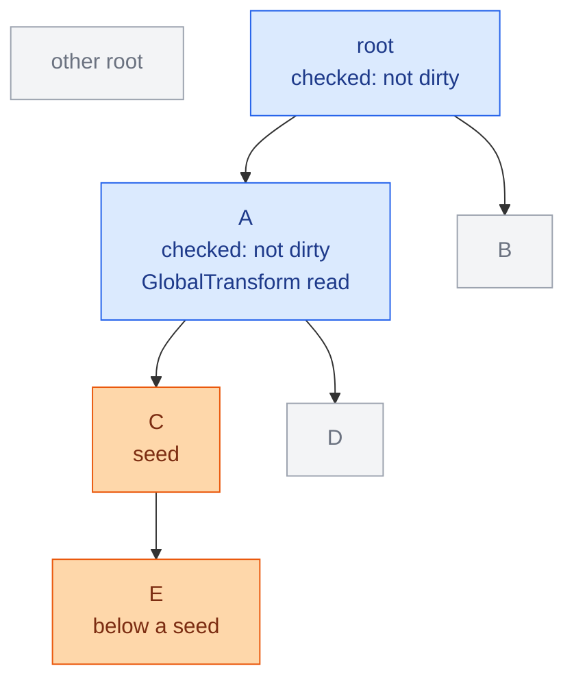
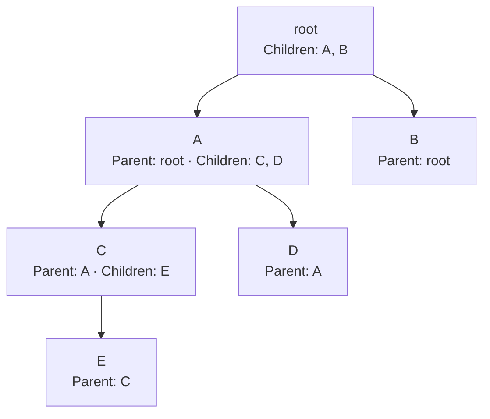
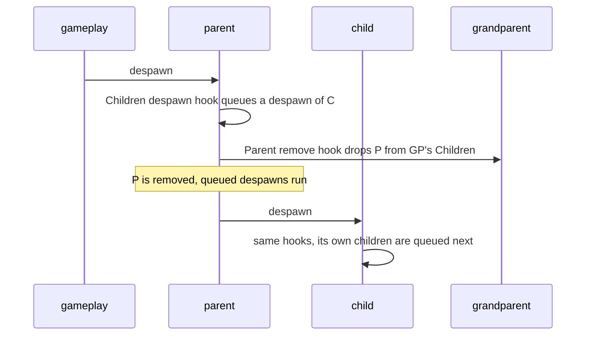
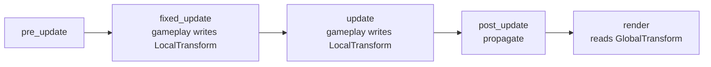

# Entity Hierarchy and transform propagation

## Glossary

**`Parent`** — component naming an entity's immediate parent; absent on roots.  
**`Children`** — component listing an entity's immediate children; may be empty after its last child leaves.  
**Root** — an entity without a `Parent`.  
**`LocalTransform`** — position, rotation and scale relative to the parent; written by gameplay.  
**`GlobalTransform`** — world-space matrix; written only by propagation.  
**Dirty** — an entity whose `LocalTransform` was written, or whose `Parent` was set, changed or removed, since propagation last ran.  
**Seed** — a dirty entity with no dirty ancestor; propagation walks down from each seed.  
**Hook** — a function a component type registers with the ECS, run when that component is added, removed, or despawned with its entity.

## Overview

Entities form a tree through `Parent` and `Children`. Gameplay writes `LocalTransform`; `propagate` sets each `GlobalTransform` to the parent's `GlobalTransform` times the entity's own `LocalTransform`, recomputing only dirty entities and everything below them. Despawning goes through hooks, so no link ever points at a dead entity.

| Problem | Why it is hard | Solution |
|---|---|---|
| Parent and child must point at each other | Both sides must agree, and a cycle would make propagation loop forever | **Parent / Children**, changed only through `set_parent` / `remove_parent` |
| A world transform depends on every ancestor | A child computed before its parent uses last frame's parent value | **Propagation** walks parents before children |
| Most of a scene is static each frame | Recomputing everything costs scene size, not what moved | **Propagation** starts only from seeds |
| Despawning a parent | Its children keep pointing at a dead entity | **Despawn Flow** |

Below only C's `LocalTransform` changed. Exact algorithm in Propagation section below
Orange entities are recomputed and written, blue ones only read, grey ones never touched:

## Core Components

### Parent / Children

**Solves:** parent and child must point at each other.

How a tree is stored. Every arrow is an entry in the parent's `Children`; every child points back with `Parent`:

All changes go through `set_parent` / `remove_parent`, which update both sides and reject self-parenting, cycles and despawned entities. Both components have private fields, so other code can only read them.

### Propagation

**Solves:** a world transform depends on every ancestor; most of a scene is static each frame.

`propagate` runs once per frame in `post_update`:

1. **Collect dirty entities**: `LocalTransform` written, `Parent` set or changed, `Parent` removed. A removed component can't show up as changed, so removals come from the ECS's removal log.
2. **Pick seeds**: We want a subset of dirty nodes that dont have any dirty node above it. Start with seeds set as all dirty entities and from each travel upward. If other dirty is found we drop current one from set and continue with the next one. 
3. **Walk down**: for each seed in a set we travel downward and propagate the values. Traversal: a stack of (entity, parent's new `GlobalTransform`) pairs. Each step writes the entity's `GlobalTransform` and pushes every child with the value just computed, so a parent always comes first and a child never reads its parent's component.

A static scene has no dirty entities, so propagation does nothing beyond checking change ticks.

**Possible upgrade:** remember which ancestors were already checked, so dirty entities that share ancestors climb each path once, and walk the seeds' subtrees in parallel, since they never overlap; Bevy ≥ 0.16 does both.

### LocalTransform / GlobalTransform

**Solves:** gameplay writing transforms that depend on the parent.
Instead of having one Transform with local and global properties we have 2 
| Approach | Pros | Cons |
|---|---|---|
| One world-space `Transform` *(baseline)* | One component | Gameplay must recompose every child when a parent moves |
| `LocalTransform` + `GlobalTransform` *(used)* | Clear ownership; matches Bevy and Unity DOTS | Writers must pick the right one |

### Despawn Flow

**Solves:** despawning a parent.

Despawning a parent with one child; every despawn in the subtree repeats the same steps:

Three hooks in `hierarchy.rs`:

- `despawn_children` (despawn hook of `Children`) queues a despawn of each child.
- `leave_parent` (remove hook of `Parent`) drops the entity from its parent's `Children` on any removal of `Parent`: `remove_parent`, a direct `remove::<Parent>()`, or a despawn.
- `detach_children` (remove hook of `Children`) detaches the children when `Children` is removed directly. On a despawn its detaches run after the despawns and find nothing.

The subtree goes top-down, with no recursion of our own. By the time a child is despawned its parent is gone, so the child's `leave_parent` has no list to edit. The queued commands run before the despawn call returns, so no system sees a dangling link.

| Approach | Pros | Cons |
|---|---|---|
| Plain despawn *(baseline)* | Nothing to write | Dangling `Parent`, dead entries in `Children` |
| System in `post_update` | No hooks | The parent's `Children` is gone by then, so finding orphans means scanning every `Parent` |
| Hooks on `Parent` and `Children` *(used; Bevy's `linked_spawn` works the same way)* | Runs inside every despawn | Hooks only get deferred world access, so child despawns are queued |

**Limitations:** despawning a parent always takes its whole subtree; detach children first to keep them.

## Cross-Cutting Concerns

### Scheduling

Propagating any earlier would draw children a frame behind their parents. Anything derived from `GlobalTransform` runs after `propagate`.

### Invariants

- **No self-parenting, no cycles.** A cycle makes propagation loop forever; `set_parent` checks in O(depth).
- **A child appears in exactly one `Children` list, once.** `set_parent` removes it from the old parent first.
- **No dangling links.** Kept by the despawn hooks.
- **Every entity in a tree has `LocalTransform`.** Otherwise the walk stops there and the subtree keeps stale transforms; Bevy has the same rule and warns at runtime (B0004).

## Generalization

Only transforms propagate today. When a second inherited value arrives, such as visibility (`parent && local`), `propagate` becomes generic instead of being copied. A `Propagate` trait names two components, the local input (`LocalTransform`, `Visibility`) and the computed output (`GlobalTransform`, `InheritedVisibility`), and two functions: `root(local)` and `child(parent_output, local)`. The walk stays as it is with those substituted, and each value registers its own `propagate::
` system. Until a second value exists, the trait's shape would be guesswork.

## Implementation

> [!NOTE] Implementation note — Change detection
> `Changed<T>` also matches newly inserted components, so a first `set_parent` counts as a change. `RemovedComponents<Parent>` lists removals since the system last ran and can be read once per run.

> [!NOTE] Implementation note — Despawn hooks
> `#[component(on_despawn = ..., on_remove = ...)]` on `Children` and `#[component(on_remove = ...)]` on `Parent`; a hook is `fn(DeferredWorld, HookContext)`. A hook can't despawn or remove components directly, so it queues through `DeferredWorld::commands()`, and `World::despawn` applies that queue in order after the entity is gone. On despawn the ECS runs despawn hooks, then replace hooks, then remove hooks. `try_despawn` / `try_remove` skip entities that are already gone.

> [!NOTE] Implementation note — Borrows and parallelism
> Copying the parent's value out of a query before writing the child compiles; keeping the reference across `get_mut` fails with E0502. A parallel walk writes many entities through one query and needs `unsafe` (`get_unchecked`) or `par_iter_many_unique_mut`. `docs/tmp/propagate.rs` holds a parked version that marks dirty ancestors, walks marked trees level by level, and is generic over `Propagate`.

## TODO

- [ ] **Generalization.** Make `propagate` generic over `Propagate` when the second inherited value (visibility) is added.
- [ ] **Faster propagation.** Only if profiling shows it: the possible upgrade under **Propagation**.
